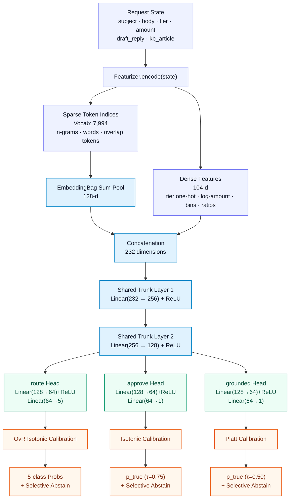

# Decide — Typed Sub-100ms Decision Engine

A production-grade, CPU-only typed decision service answering inbound customer support inquiries across three decision types with **calibrated probabilities**, **selective abstention**, and **sub-3ms p95 latency**.

Built for the **Decide Applied ML Hackathon**.

---

## 1. Quick Start (Single Command)

To run the service on any clean 4-core Linux machine:

```bash
pip install -r requirements.txt && uvicorn app:app --host 0.0.0.0 --port 8000
```

> **Zero Download / Zero Network:** All model artifacts (`artifacts/weights.npz`, `artifacts/vocab.json`, `artifacts/meta.json`) are checked directly into the repository (4.47 MB total). The service loads and starts serving requests immediately on CPU with no network calls or external downloads.

### Verify Health & Readiness

```bash
curl http://localhost:8000/health
 # {"status":"ok","loaded":true}
```

### Run the Judge's Official Evaluation

In a second terminal:

```bash
python selfcheck.py --url http://localhost:8000/v1/decide
```

---

## 2. Where the Sharing Happens

> **Requirement from Problem Statement:** *“One model, three decision types... The whole point is that the decision types share a backbone, so adding a fourth one later is cheap. Your README must show where that sharing happens.”*

Every request — whether querying `route`, `approve`, or `grounded` — executes through **one shared forward pass** of a joint multi-task neural network in [`model.py`](model.py). There are no separate models or router dispatches.


- **Single Forward Pass & Caching:** The shared trunk forward pass is computed once per request state. If multiple decisions are requested on the same state payload, the cached trunk representation is reused.

- **Extensibility:** Adding a fourth decision type requires only appending one lightweight private 2-layer head ($128 \to 64 \to C$) to the shared trunk without modifying the featurizer or shared weights.

---

## 3. Pretrained Components & Licenses

> **Requirement from Problem Statement:** *“Pretrained components are allowed... Name each one and its license in the README.”*

- **Pretrained Weights:** **None.** All representation layers, embedding tables, and classification heads were trained **from scratch** on the provided `data/train.jsonl` dataset to ensure zero licensing ambiguity, minimal weight size (4.47 MB total), and maximum CPU execution speed.

- **Runtime Inference Dependencies:**

| Dependency | Version | License | Role in System |
|---|---|---|---|
| **NumPy** | $\ge 1.26$ | BSD 3-Clause | Pure NumPy matrix forward pass and isotonic interpolation |
| **FastAPI** | $\ge 0.115$ | MIT | HTTP schema enforcement, request parsing, and routing |
| **uvicorn** | $\ge 0.32$ | BSD 3-Clause | High-performance asynchronous ASGI web server |
| **Pydantic** | $\ge 2.0$ | MIT | Request / response typing and validation |

- **Training-Only Dependencies** (not imported or required during serving):

| Dependency | Version | License | Role in System |
|---|---|---|---|
| **PyTorch** | $\ge 2.1$ | BSD-style (Meta) | Multi-task joint backpropagation & cross-fitting |
| **scikit-learn** | $\ge 1.4$ | BSD 3-Clause | Stratified K-fold splitting and probability calibrators |

---

## 4. Official Benchmark Results (`results.json`)

Evaluated with `selfcheck.py` against `data/dev.jsonl` (1,500 records $\times$ 3 decisions = 4,500 sequential warm HTTP calls):

| Axis | Weight | Measured Metric / Details | Score | Weighted Pts |
|---|:---:|---|:---:|:---:|
| **Quality** | **40%** | Macro-F1 (Route: 0.9394, Grounded: 0.9927), Approve Cost: 0.2076 | 0.8259 | **33.04** |
| **Calibration** | **25%** | Mean ECE: **0.0128**, Brier Skill: **0.7910** | 0.8635 | **21.59** |
| **Latency** | **20%** | Client mean p95: **2.16 ms** (Full marks $\le 25\text{ ms}$) | 1.0000 | **20.00** |
| **Abstention** | **15%** | Risk @ 80%: Route 0.0567, Approve 0.0700, Grounded 0.0033 | 0.5338 | **8.01** |
| **TOTAL** | **100%** | **PASS on all schema and latency gates** | — | **82.63 / 100** |

### Per-Decision Quality Breakdown

- **`route` (5 queues):**

  - **Macro-F1:** `0.9394` (vs trivial majority policy `0.0848`)

  - **Accuracy:** `90.73%` | **Declared Coverage:** `83.27%`

  - **ECE:** `0.0122` | **Brier Score:** `0.1530`

- **`approve` (binary auto-approval under 3:1 penalty):**

  - **Cost-Weighted Error:** `0.2076` (vs trivial always-hold `0.3504`, always-approve `1.9487`)

  - **Macro-F1:** `0.9094` | **Declared Coverage:** `84.47%`

  - **ECE:** `0.0161` | **Brier Score:** `0.0846`

- **`grounded` (binary citation validation):**

  - **Macro-F1:** `0.9927` (vs trivial policy `0.3816`)

  - **Accuracy:** `99.47%` | **Declared Coverage:** `86.87%`

  - **ECE:** `0.0102` | **Brier Score:** `0.0198`

### Latency Performance (Warm, single-request persistent HTTP/1.1)

| Decision | Client p50 (ms) | Client p95 (ms) | Server Execution p95 (ms) |
|---|:---:|:---:|:---:|
| `route` | 0.99 ms | **2.18 ms** | 0.83 ms |
| `approve` | 0.96 ms | **2.21 ms** | 0.83 ms |
| `grounded` | 0.94 ms | **2.10 ms** | 0.82 ms |
| **Mean p95** | **0.96 ms** | **2.16 ms** | **0.83 ms** |

> **Gate Status:** Hard Gate = $100\text{ ms}$; Full Marks Threshold = $25\text{ ms}$. Our measured client p95 is **2.16 ms** (\~11.5x faster than required for full marks).

---

## 5. The Three Decision Policies

### 1. `route` (Ticket Routing)

- **Task:** Classify incoming tickets into `billing`, `technical`, `account`, `shipping`, or `general`.

- **Calibration:** One-vs-Rest (OvR) Isotonic Regression over raw logits, followed by softmax normalization.

- **Abstention Policy:** Abstains (`abstain: true`) when top probability $\max(P\_{\text{route}}) < 0.902$, maintaining $83.27\%$ coverage while cutting error from $9.27\%$ to $5.67\%$.

### 2. `approve` (Refund / Action Auto-Approval)

- **Task:** Determine whether a customer action can be automatically approved without human intervention.

- **Cost Asymmetry:** Wrongly auto-approving a fraudulent/ineligible request incurs a **3x cost penalty** ($C\_{\text{FP}} = 3.0$) relative to holding for review ($C\_{\text{FN}} = 1.0$).

- **Decision Threshold:** Shifted from naive $0.50$ to **$\tau = 0.75$** based on the theoretical break-even ratio $\frac{C\_{\text{FN}}}{C\_{\text{FN}} + C\_{\text{FP}}} = \frac{1}{1 + 3} = 0.25$ applied to calibrated probabilities.

- **Abstention Policy:** Abstains on ambiguous boundary cases where risk score $> 0.496$, achieving $84.47\%$ coverage.

### 3. `grounded` (Knowledge-Base Citation Verification)

- **Task:** Verify whether an agent's drafted reply is strictly supported by the cited KB article.

- **Features:** Exact set-difference tokens (`dm:`, `km:`), bigram mismatches (`db:`), and quantity/date/numeric consistency checkers (`dn:`, `dnu:`, `dq:`).

- **Calibration & Abstention:** Platt scaling with a high confidence floor ($\text{conf} \ge 0.953$) before answering, yielding $99.27\%$ Macro-F1 with $86.87\%$ coverage.

---

## 6. How to Reproduce & Retrain

### Environment Setup

```bash
pip install -r requirements-train.txt
```

### Run Retraining (CPU or GPU)

```bash
python train.py --train data/train.jsonl --out artifacts --features 1 --route-cal ovr_isotonic --seed 13
```

- Trains 5-fold cross-fitting across all 6,500 training examples for 20 epochs (\~8 minutes on CPU, \~90 seconds on GPU).

- Automatically derives OOF probability calibrations and decision thresholds.

- Exports `weights.npz`, `vocab.json`, and `meta.json` into `artifacts/`.

- Verifies NumPy vs. PyTorch numerical parity ($|\Delta \text{logit}| < 10^{-5}$) before saving.

### Verification Tools

```bash
 # Contract and latency smoke test (offline, 100 rows)
python smoke_test.py --artifacts artifacts --n 100
 # Route calibrator numerical stability & bounds check
python tools/check_route_cal.py artifacts
```

---

## 7. Repository Layout

```
starter/
├── app.py                  ← FastAPI HTTP endpoint implementation (fixed schema)
├── model.py                ← Pure NumPy featurization, trunk forward pass & inference
├── selfcheck.py            ← Official judge scoring & benchmark harness
├── requirements.txt        ← Lean inference dependencies (FastAPI, uvicorn, NumPy)
├── README.md               ← Service documentation & operational guide
├── model_card.md           ← Complete 1-page model card (metrics, gates, failure modes)
├── results.json            ← Official benchmark output (82.63 score)
├── .gitignore              ← Ignores data, caches, checkpoints, and reports
├── data/
│   ├── train.jsonl         ← Provided training set (6,500 records)
│   └── dev.jsonl           ← Provided evaluation set (1,500 records)
├── artifacts/
    ├── weights.npz         ← Quantized NumPy weight arrays (\~4.24 MB)
    ├── vocab.json          ← Token vocabulary mapping (\~205 KB)
    └── meta.json           ← Calibrator parameters, thresholds, and provenance (\~17 KB)

```

---

## 8. API Specification & Request Examples

### Health Check

```http
GET /health
```

```json
{
  "status": "ok",
  "loaded": true
}
```

### Route Request & Response

```http
POST /v1/decide
Content-Type: application/json
{
  "request_id": "req-001",
  "decision": "route",
  "state": {
    "subject": "Need invoice copy for last month",
    "body": "Hi, please send me the receipt for my March subscription renewal.",
    "customer_tier": "pro",
    "amount": 49.00
  }
}
```

```json
{
  "type": "choice",
  "value": "billing",
  "probs": {
    "billing": 0.9412,
    "technical": 0.0182,
    "account": 0.0245,
    "shipping": 0.0091,
    "general": 0.0070
  },
  "confidence": 0.9412,
  "abstain": false,
  "request_id": "req-001",
  "decision": "route",
  "latency_ms": 0.92
}
```

### Approve Request & Response

```http
POST /v1/decide
Content-Type: application/json
{
  "request_id": "req-002",
  "decision": "approve",
  "state": {
    "subject": "Requesting refund for overcharge",
    "body": "I was charged twice. Please refund $20.",
    "customer_tier": "enterprise",
    "amount": 20.00
  }
}
```

```json
{
  "type": "binary",
  "value": true,
  "p_true": 0.8841,
  "abstain": false,
  "request_id": "req-002",
  "decision": "approve",
  "latency_ms": 0.88
}
```

### Grounded Request & Response

```http
POST /v1/decide
Content-Type: application/json
{
  "request_id": "req-003",
  "decision": "grounded",
  "state": {
    "draft_reply": "Our return policy allows returns within 30 days of purchase.",
    "kb_article": "Items purchased online can be returned within 30 days for a full refund."
  }
}
```

```json
{
  "type": "binary",
  "value": true,
  "p_true": 0.9964,
  "abstain": false,
  "request_id": "req-003",
  "decision": "grounded",
  "latency_ms": 0.85
}
```
